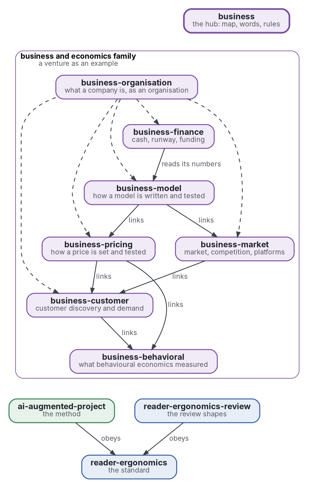

# Entreprise et économie

[](https://github.com/Tewf/business/actions/workflows/checks.yml)
[](https://tewf.github.io/business/)

La page d'accueil d'une famille de dépôts sur l'**entreprise et l'économie** : le commerce dont une entreprise a besoin, l'économie qui le sert, et l'économie comportementale. Elle est écrite pour toute entreprise et pour le grand public. Cette page tient la carte, les mots que les membres partagent et les règles qu'ils suivent. Elle ne tient rien qui appartienne à un membre.

Cette page en anglais : [README.md](README.md). Les deux versions suivent le même état.

> **État (2026-11-04) :** mis en place ; rien n'est encore écrit au-delà du périmètre. Le premier travail est une revue
> de littérature, non commencée. Le nom est provisoire jusqu'à ce que la première étape de cette revue dise comment le
> domaine nomme la chose. Ce n'est ni une norme officielle, ni une étude relue par des pairs, ni un résultat nouveau.
>
> **Comment il est fait :** avec Claude, un assistant IA d'Anthropic, sous la direction du mainteneur, comme
> reader-ergonomics. Une entreprise n'apparaît que comme exemple, une entreprise qui personnalise un produit. Les corrections sont bienvenues sous forme d'issues.

## La carte


<details>
<summary>Source Graphviz</summary>



</details>

| Membre | Problème | État |
|---|---|---|
| [business-model](https://github.com/Tewf/business-model) | comment le modèle d'une entreprise s'écrit et se teste : valeur, clients, canaux, revenus, coûts, économie unitaire | périmètre posé le 2026-11-04 ; première revue non commencée |
| [business-pricing](https://github.com/Tewf/business-pricing) | comment un prix se fixe et se teste : disposition à payer, prix personnalisé, ancres | périmètre posé le 2026-11-04 ; première revue non commencée |
| [business-customer](https://github.com/Tewf/business-customer) | découverte du client et estimation de la demande : entretiens, enquêtes, expériences, modèles de choix | périmètre posé le 2026-11-04 ; première revue non commencée |
| [business-finance](https://github.com/Tewf/business-finance) | trésorerie, autonomie, seuil de rentabilité et économie du financement d'une petite entreprise | périmètre posé le 2026-11-04 ; première revue non commencée |
| [business-behavioral](https://github.com/Tewf/business-behavioral) | ce que l'économie comportementale a mesuré et qu'une entreprise peut employer honnêtement, avec le statut de réplication | périmètre posé le 2026-11-04 ; première revue non commencée |
| [business-market](https://github.com/Tewf/business-market) | taille du marché, différenciation, concurrence, plateformes et économie de la personnalisation | périmètre posé le 2026-11-04 ; première revue non commencée |
| [business-organisation](https://github.com/Tewf/business-organisation) | ce qu'est une entreprise en tant qu'organisation : les processus qu'elle fait tourner, les quatre problèmes d'organisation, les droits de décision, le traitement de l'information et l'adaptation | posé le 2026-11-11 ; première revue écrite, finie sur la référence B1 |

En dehors de cette famille, deux dépôts tiennent ce que les membres emploient. La méthode (cadrer, revoir, fixer une référence, planifier) est celle d'[ai-augmented-project](https://github.com/Tewf/ai-augmented-project), et les formes d'une revue sont celles de [reader-ergonomics-review](https://github.com/Tewf/reader-ergonomics-review). Chaque membre obéit à [reader-ergonomics](https://github.com/Tewf/reader-ergonomics/blob/2e5b6f0c3e67d2dc8195a63cf882d46170e79a5a/standard.md) (v1.21.0) et exécute ses vérifications en CI.

## Les règles

- **Un dépôt par problème.** Un membre répond à une question ; une seconde question est un second dépôt.
- **Aucun recouvrement.** Un fait vit dans un membre ; les autres le lient.
- **Rien de privé.** Aucun nom d'entreprise, aucun partenaire, aucun plan interne et aucun chiffre d'une entreprise réelle n'apparaît dans un membre. Une entreprise est un exemple, jamais un sujet : le seul exemple est une entreprise qui personnalise un produit.
- **Chaque nombre vient d'une source ou d'une exécution.** Un nombre porte la page où il a été lu ou le programme qui l'a calculé. Un nombre sans l'un ni l'autre est marqué PROVISIONAL.
- **Les dépendances pointent vers le bas.** Un membre emploie ce qui est en dessous et rien au-dessus ; cette page lie chaque membre et rien ne lie cette page.
- **Deux registres gardent le travail honnête.** Un **registre des décisions** tient une fiche par choix qui avait des alternatives, dans la forme de la fiche de décision de la famille. Un **registre des valeurs provisoires** liste chaque nombre marqué PROVISIONAL jusqu'à l'arrivée de sa source.
- **Un modèle ne décide rien.** Sa sortie est vérifiée par un programme ou lue par la personne, comme dans ai-augmented-project.

## Les mots

| Mot | Sens ici |
|---|---|
| **entreprise naissante** | une jeune entreprise qui vend un produit et n'a pas encore trouvé son modèle |
| **modèle d'affaires** | comment une entreprise crée de la valeur, atteint ses clients, gagne des revenus et supporte des coûts |
| **économie unitaire** | ce que rapporte un client et ce qu'il coûte |
| **disposition à payer** | le plus qu'un acheteur paierait, mesuré par un acte ou par une réponse |
| **autonomie de trésorerie** | combien de temps l'argent dure au rythme actuel de dépense |
| **incitation** | un changement de la présentation d'un choix qui laisse toute option ouverte et met l'intérêt du client d'abord |
| **motif trompeur** | une conception qui oriente un choix contre l'intérêt du client |
| **plan en trois états** | un plan pour avant le lancement, au lancement et à l'échelle, avec l'événement qui fait passer d'un état à l'autre |
| **référence** | le résultat existant auquel on compare un résultat nouveau ; une revue s'achève quand elle peut en nommer une |

## L'ordre des premières revues

Les trois premières questions viennent d'abord, parce que les autres lisent leurs réponses. Puis les trois qui les soutiennent.

1. **[business-model](https://github.com/Tewf/business-model)**: les autres le lisent ; sa sous-question juridique, qui est la personne responsable d'un produit qu'un partenaire fabrique et quel contrat le rend vrai, peut décider tout le modèle.
2. **[business-pricing](https://github.com/Tewf/business-pricing)**: ce que les gens paient pour un bien conçu par eux face au même bien en rayon. Elle demande comment le mesurer avant toute vente : disposition à payer, prime de la conception par soi-même, lecture d'une liste d'attente.
3. **[business-finance](https://github.com/Tewf/business-finance)**: combien de temps la trésorerie dure quand le premier revenu arrive longtemps après l'immatriculation. Elle demande quels choix, gratuits jusqu'à un événement, le maintiennent vrai ; rien n'est payé avant son événement, comme principe de conception.
4. **[business-customer](https://github.com/Tewf/business-customer)**: il fournit les données de demande que lisent la tarification et le marché, et suit la tarification dès qu'elle a dit ce dont elle a besoin.
5. **[business-behavioral](https://github.com/Tewf/business-behavioral)**: la prime de la conception par soi-même est un effet documenté, non une astuce de prix, donc la revue de tarification s'y appuie ; sa propre revue suit pour établir ce qui se réplique.
6. **[business-market](https://github.com/Tewf/business-market)**: il compte quand le modèle, le prix et la trésorerie tiennent ; ses méthodes de taille ont d'abord besoin des données de demande.

## Le premier travail : une revue de littérature

Non commencée. Elle cadre la famille avant la revue de tout membre, et elle est finie quand elle peut nommer la référence.

1. **Cadrer :** comment le domaine nomme cette famille : économie d'entreprise, économie managériale, finance entrepreneuriale et recherche en entrepreneuriat sont des pistes à vérifier. Le préfixe peut changer alors.
2. **Revue :** si le domaine trace les mêmes six lignes, trouvé dans ses programmes et ses manuels, les synthèses d'abord.
3. **État de l'art, et le dossier contre.**
4. **Positionnement :** ce que cette famille demande et que le domaine ne répond pas déjà.
5. **Référence :** la division du sujet par le domaine lui-même, mise face à cette carte.

## Questions auxquelles la revue doit répondre

- **Le découpage.** Le domaine divise-t-il le sujet en ces six, et où trace-t-il une ligne ailleurs ?
- **L'ordre.** L'ordre des premières revues suit-il l'ordre de dépendance entre les problèmes ?
- **Usage honnête.** Quelles règles d'emploi de l'économie comportementale sur les clients le domaine tient-il déjà, et lesquelles laisse-t-il ouvertes ?

## Vérifier

```sh
git clone https://github.com/Tewf/reader-ergonomics
python3 reader-ergonomics/checks/run.py chemin/vers/ce/depot
```

La CI exécute les mêmes vérifications à chaque push, et une exécution échoue à la première erreur
([checks.yml](https://github.com/Tewf/business/blob/master/.github/workflows/checks.yml)). Chaque push sur
master construit aussi le site, [tewf.github.io/business](https://tewf.github.io/business/)
([pages.yml](https://github.com/Tewf/business/blob/master/.github/workflows/pages.yml)).

## Contenu

| Partie | Résumé |
|---|---|
| [decisions](decisions/) | une fiche par choix qui façonne ce dépôt, chacune ouvrant sur la décision en une phrase |

## Licence

Code sous [Apache License 2.0](LICENSE) ; prose sous [CC BY 4.0](LICENSES/CC-BY-4.0.txt). Réutilisez-le comme vous le
souhaitez, en créditant ce dépôt ; [CITATION.cff](CITATION.cff) donne une citation si besoin.
