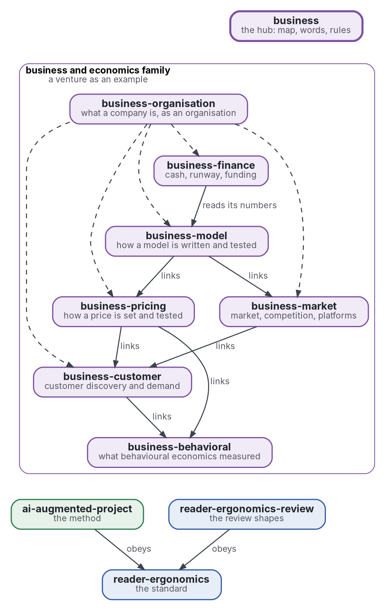

# Business and economics

[](https://github.com/Tewf/business/actions/workflows/checks.yml)
[](https://tewf.github.io/business/)

The front page of a family of repositories on **business and economics**: the business a venture needs, the economics that serves it, and behavioural economics. It is written for any venture and for the general public. This page holds the map, the words the members share and the rules they obey. It holds nothing a member owns.

This page in French: [README.fr.md](README.fr.md).

> **Status (2026-11-04):** set up; nothing is written yet beyond the scope. The first job is a literature review, not
> started. The name is provisional until that review's first step says what the field calls this. It is not an
> official standard, not a peer-reviewed study and not a new result.
>
> **How it is made:** with Claude, an AI assistant by Anthropic, under the maintainer's direction, the way
> reader-ergonomics was made. A venture appears only as an example, a venture that personalises a product. Corrections are welcome as issues.

## The map


<details>
<summary>Graphviz source</summary>



</details>

| Member | Problem | Status |
|---|---|---|
| [business-model](https://github.com/Tewf/business-model) | how a venture's model is written and tested: value, customers, channels, revenue, costs, unit economics | scope set out 2026-11-04; first review not started |
| [business-pricing](https://github.com/Tewf/business-pricing) | how a price is set and tested: willingness to pay, personalised pricing, anchors | scope set out 2026-11-04; first review not started |
| [business-customer](https://github.com/Tewf/business-customer) | customer discovery and demand estimation: interviews, surveys, experiments, choice models | scope set out 2026-11-04; first review 2026-11-04, B1 named |
| [business-finance](https://github.com/Tewf/business-finance) | cash, runway, break-even and the economics of funding for a small venture | scope set out 2026-11-04; first review not started |
| [business-behavioral](https://github.com/Tewf/business-behavioral) | what behavioural economics measured that a venture can use honestly, with replication status | scope set out 2026-11-04; first review not started |
| [business-market](https://github.com/Tewf/business-market) | market sizing, differentiation, competition, platforms and the economics of personalisation | scope set out 2026-11-04; first review not started |
| [business-organisation](https://github.com/Tewf/business-organisation) | what a company is, as an organisation: the functions it must perform, the roles and structure that perform them, how it is written as an information-processing system, and how it adapts | set out 2026-11-11; first review 2026-11-11, B1 named |

Outside this family, two repositories hold what the members use. The method (scope, review, baseline, plan) is [ai-augmented-project](https://github.com/Tewf/ai-augmented-project)'s, and the shapes of a review are [reader-ergonomics-review](https://github.com/Tewf/reader-ergonomics-review)'s. Every member obeys [reader-ergonomics](https://github.com/Tewf/reader-ergonomics/blob/2e5b6f0c3e67d2dc8195a63cf882d46170e79a5a/standard.md) (v1.21.0) and runs its checks in CI.

## The rules

- **One repository per problem.** A member answers one question; a second question is a second repository.
- **No overlap.** A fact lives in one member; the others link it.
- **Nothing private.** No company name, no partner, no internal plan and no figure of a real venture appears in any member. A venture is an example, never a subject: the only example is a venture that personalises a product.
- **Every number from a source or a run.** A number carries the page it was read on or the program that computed it. A number with neither is tagged PROVISIONAL.
- **Dependencies point down.** A member uses what sits below it and nothing above; this page links every member and nothing links this page.
- **Two registers keep the work honest.** A **decision register** holds one record per choice that had alternatives, in the shape of the family's decision record. A **provisional-values register** lists every number tagged PROVISIONAL until its source arrives.
- **A model decides nothing.** Its output is checked by a program or read by the person, as in ai-augmented-project.

## The words

| Word | Meaning here |
|---|---|
| **venture** | a young business that sells a product and has not yet found its model |
| **business model** | how a venture creates value, reaches customers, earns revenue and bears costs |
| **unit economics** | what one customer earns and what one customer costs |
| **willingness to pay** | the most a buyer would pay, measured by an act or by an answer |
| **runway** | how long cash lasts at the current rate of spending |
| **nudge** | a change to how a choice is shown that keeps every option open and the customer's interest first |
| **dark pattern** | a design that steers a choice against the customer's interest |
| **three-state plan** | a plan for before launch, at launch and at scale, with the event that moves each state |
| **baseline** | the existing result a new one is compared against; a review ends when it can name one |

## The order of the first reviews

The first three questions come first, because the others read their answers. Then the three that support them.

1. **[business-model](https://github.com/Tewf/business-model)**: the others read it; its legal sub-question, who is the responsible party for a product a partner makes and what contract makes that true, can decide the whole model.
2. **[business-pricing](https://github.com/Tewf/business-pricing)**: what people pay for a self-designed good against the same good off the shelf. It asks how to measure that before any sale: willingness to pay, the premium for self-design, how a waiting list is read.
3. **[business-finance](https://github.com/Tewf/business-finance)**: how long cash lasts when first revenue arrives long after registration. It asks which choices, free until an event, keep that true; nothing is paid before its event, as a design principle.
4. **[business-customer](https://github.com/Tewf/business-customer)**: it supplies the demand data that pricing and the market read, and follows pricing as soon as pricing has named what it needs.
5. **[business-behavioral](https://github.com/Tewf/business-behavioral)**: the self-design premium is a documented effect, not a pricing trick, so the pricing review leans on it; its own review follows to settle what replicates.
6. **[business-market](https://github.com/Tewf/business-market)**: it matters once the model, the price and the cash hold; its sizing methods need the demand data first.

## The first job: a literature review

Not started. It frames the family before any member's review, and it is finished when it can name the baseline.

1. **Frame:** what the field calls this family: business economics, managerial economics, entrepreneurial finance and entrepreneurship research are leads to verify. The prefix may change then.
2. **Review:** whether the field draws the same six lines, found in its curricula and handbooks, surveys first.
3. **State of the art, and the case against.**
4. **Position:** what this family asks that the field does not already answer.
5. **Baseline:** the field's own division of the subject, set against this map.

## Questions the review must answer

- **The split.** Does the field divide the subject into these six, and where does it draw a line elsewhere?
- **The order.** Does the order of the first reviews match the order of dependence between the problems?
- **Honest use.** Which rules for using behavioural economics on customers does the field already hold, and which does it leave open?

## Check it

```sh
git clone https://github.com/Tewf/reader-ergonomics
python3 reader-ergonomics/checks/run.py path/to/this/repository
```

CI runs the same checks on every push, and a run fails on any error
([checks.yml](https://github.com/Tewf/business/blob/master/.github/workflows/checks.yml)). Every push to
master also renders the site, [tewf.github.io/business](https://tewf.github.io/business/)
([pages.yml](https://github.com/Tewf/business/blob/master/.github/workflows/pages.yml)).

## Contents

| Part | Summary |
|---|---|
| [decisions](decisions/) | one record per choice that shapes this repository, each opening with the decision in one sentence |

## Licence

Code under the [Apache License 2.0](LICENSE); prose under [CC BY 4.0](LICENSES/CC-BY-4.0.txt). Reuse it as you wish,
with credit to this repository; [CITATION.cff](CITATION.cff) gives a citation if you need one.
